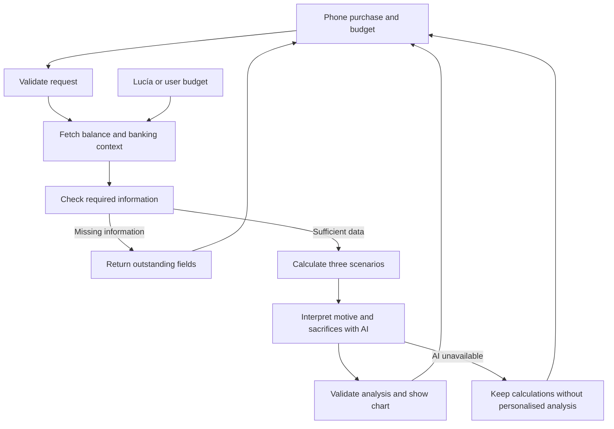

# SpendLab implementation plan

SpendLab helps a Banana Bank customer decide whether to buy a phone outright. It combines their current bank balance, an explicit budget and their purchase motive to compare buying now, selling their previous phone first and waiting. The experience stands out through an interactive chart and analysis that connects financial consequences with what the person hopes to achieve.

V1 is saved in `d87a68e`, including the interface, and the user has reviewed its first version positively. It uses the current date independently of the documentation system, a sample budget for Lucía and manual budgets for everyone else. V1.1, described below, has been implemented following specification approval and is awaiting the user's visual review and a commit. It does not include persistence. Validation evidence and the walkthrough are in [HowToDemo](../../docs/demo/HowToDemo.md).

## V1 · Original baseline retained for reference

### Documents and shared decisions

- [Backend](Backend.md): sources, budget, dates, HTTP contracts, calculations, workflow and interpretation.
- [Frontend](Frontend.md): short form, data review, chart, analysis and states.
- This plan: scope, integration, iterations and acceptance criteria.

Types and financial rules are defined in Backend and shared with the frontend. The model interprets results that have already been calculated; it does not determine balances, formulas or financial classifications.

| Decision        | MVP                                                                                                  |
| --------------- | ---------------------------------------------------------------------------------------------------- |
| Name            | SpendLab; visible label `Spend Lab`.                                                                 |
| Purchase        | One phone, paid outright in euros. No category selector or product catalogue.                        |
| Comparison      | Buy today, sell first and wait; budget baseline as the chart reference.                              |
| Demo            | Lucía, with a small, fictional, editable budget.                                                     |
| Other customers | Actual API balance and a manually entered budget.                                                    |
| Time            | Today according to the server clock in UTC; a shared 90-day horizon. Injectable clock for tests.     |
| Resources       | Accounts explicitly selected by the customer and an editable safety reserve.                         |
| AI              | One call interpreting motives, sacrifices and alternatives, with a personalised reflection question. |
| Infrastructure  | Existing Next.js, React, Zod, OpenAI SDK, banking client and tracing; no new dependencies.           |
| Persistence     | One Lucía fixture and local section state. No new tables or decision history.                        |
| Language        | English in the product, consistent with the existing interface.                                      |

The documentation reference date retains its role for policies and versions. SpendLab neither imports it as its clock nor changes its value. The demo budget is converted into future dates relative to today; it does not depend on April, September or any other fixed month.

### Architecture and integration

Navigation remains in `app/page.tsx` and endpoints in `app/api/[...path]/route.ts`. A customer tab and a small dispatch to `src/spend-lab/` logic are added. The interface lives in dedicated components in `app/components/spend-lab/`. The core is not refactored to accommodate the feature.

Reuse `actor`, `sameOrigin`, `bankRequest`, `openai()`, `config.chatModel`, `traceLog` and existing visual patterns. The financial engine is a pure function shared by the server response and browser preview. The existing agent retains its prompts, tools and behaviour.

### MVP boundaries

- Balance and observed activity come from the bank over HTTP. Demo data and user declarations are identified separately. No budget replaces the balance or is presented as bank history.
- Only Lucía has a demo budget. Do not generate five months of history or profiles for every customer. The API's limited history is not used to infer a complete budget or future salary.
- Expected resale and the budget schedule are visible assumptions. Results explain when they depend on receiving money or maintaining those income and expense assumptions.
- The analysis considers financial affordability and personal value separately. It does not promise returns, satisfaction or an absence of risk.
- Do not modify `simulator/`, the existing agent, transfers, approvals, persistence or the RAG corpus and index.
- Financing, other categories, lists of extra expenses, a bill editor, external prices, OCR, saved history and durable workflows are out of scope.

### V1 implementation iterations

Tasks are carried out sequentially in `part-2`, in the usual environment, without new services or ports. Read the relevant local Next.js guides before writing Next.js code. Each iteration follows `AGENTS.md`: rule, starting scenario, evidence, decision, implementation, repetition, checks, HowToDemo, user review and commit.

| Iteration                        | Deliverable                                                                         | Validation and demo                                                                                                                           |
| -------------------------------- | ----------------------------------------------------------------------------------- | --------------------------------------------------------------------------------------------------------------------------------------------- |
| 1. Data and calculation          | Shared contract, Lucía budget, manual budget, injectable clock and three scenarios. | Cents, current/fixed dates, schedule, reserve, resale and waiting with controlled data. Check source separation.                              |
| 2. Workflow and API              | Authorised context, two endpoints, one AI call and calculation fallback.            | Session, ownership, missing fields, bank/model errors and different analyses for different motives with the same figures.                     |
| 3. Visual experience and closure | Phone form, compact budget, chart and personalised analysis.                        | Full demo with Lucía and a manual-budget customer, preview without stale text, person switching, core regression, tests, typecheck and build. |

Each iteration updates HowToDemo with scenarios and checks actually performed and reviews its diff against the boundaries above. Run focused tests and typecheck when changing code; API integration adds core regression checks. Closure runs `npm test`, `npm run typecheck`, `npm run build` and `git diff --check`. Existing live tests run against the usual application when available, with skipped tests reported. Additional changes require the approval specified in `AGENTS.md`.

### V1 acceptance criteria

The customer completes the purchase flow without writing in a chat, reviews their budget and reserve, selects resources and compares three alternatives on a consistent chart. The interpretation explains why the phone makes sense for their motive, what room or protection they sacrifice and what specific question they should consider before deciding.

The main demo uses Lucía and the current balance returned by the bank. Changing price, reserve or resale date recalculates a visible preview. The previous interpretation disappears until the analysis is updated. The recommendation must be able to support both an affordable treat and waiting when the purchase compromises resources.

Also demonstrate a customer without a demo profile completing their budget manually. Tests fix the date and balance; the demo does not reset the bank or assume local data remains untouched. Evaluating creates no operations, intents, approvals or conversations.

Closure also checks Overview, Assistant, Transfers, Documents and the person selector, with particular attention to late responses. The user's actual visual review and budget-model limitations are recorded in HowToDemo.

### Subsequent review

Decisions are reviewed in these specifications first, then in the corresponding task. Separating context, calculation and interpretation leaves future categories and financing possible, without adding them to the MVP during an iteration already underway.

## V1.1 · Implemented evolution, awaiting review

V1.1 expands decision context and help with preparing a budget. It reuses the existing section, two endpoints, financial engine, chart and interpretation. It does not rebuild SpendLab or add financing, product research or an agent loop.

| Aspect      | Original V1                                                                     | V1.1                                                                                                                                                                                           |
| ----------- | ------------------------------------------------------------------------------- | ---------------------------------------------------------------------------------------------------------------------------------------------------------------------------------------------- |
| Customers   | All customers can evaluate; Lucía has a demo and everyone else enters a budget. | Same access for everyone, with visible bank evidence to prepare and confirm forecasts. No customer depends on a fixture.                                                                       |
| Budget      | Preloaded Lucía demo; five manual fields for everyone else.                     | Shared flow using available actual balance and activity; complete/confirm the five fields. Lucía retains an explicit option to load the example, rather than the new flow using it by default. |
| Purchase    | Generic phone; the product may appear in free-text context.                     | Category and specific name required in the new interface, alongside price, motive and context.                                                                                                 |
| Categories  | Phones.                                                                         | Phones, computers, gaming and consoles, other technology devices.                                                                                                                              |
| AI          | Phone-focused interpretation.                                                   | Interpretation of product, motive, declared usefulness, sacrifices, alternatives and a personalised question.                                                                                  |
| Calculation | Baseline, buy now, sell first and wait, over 90 days.                           | Same formulas, scenarios and controls. Category and name do not change the figures.                                                                                                            |
| History     | Local state; evaluations are not saved.                                         | Remains outside the proposed implementation scope, pending the user's decision.                                                                                                                |

### Bank data and coverage of all customers

The issue is not enabling seven new customers: V1 already accepts their accounts and manual budgets. The improvement helps them complete that budget using the data actually available, without assigning them a fictional profile.

Reuse accounts and up to 100 transactions from the external API. The backend produces a deterministic summary of observed inflows and outflows by account and UTC month; the frontend displays only selected accounts and their coverage. This is a historical reference, not an inferred monthly budget. The limit can affect any month; returning fewer than 100 transactions does not guarantee full coverage either.

Transactions contain an amount, date, description and operation reference, but no expense categories, salary contracts or future due dates. An inflow may be an account opening or transfer; an outflow does not establish whether it is essential. V1.1 therefore does not turn totals into salary, annualise partial months or automatically fill essential/discretionary expenses or upcoming dates. The five fields remain forecasts reviewed by the person. Request information when evidence is insufficient; when activity is missing, the customer can continue with balance and a declared budget.

Keep the `bank`, `demo` and `user` sources. The bank summary derives only from actual transactions. A value confirmed or adjusted to project the future is a `user` assumption, even if history was consulted. Lucía's profile remains in its fixture, labelled as an example and activated explicitly. Do not add profiles, synthetic histories, hardcoded budgets or direct reads from the simulator database.

### Product and interpretation with one call

The new form requests category, specific product, price and motive; optional context describes expected use, need, urgency or what the person already owns. Do not add a catalogue, search, mandatory URL or technical specification sheet. [Backend](Backend.md) defines the compatible contract extension and [Frontend](Frontend.md) the controls.

The current call is sufficient as a starting point: it already receives declarations and calculated results and returns interpretation, recommendation, tradeoffs and a question. Extend its payload and instructions while retaining the configured model, structured output and fallback. Do not add another call or allow AI to change calculations or complete the budget.

AI explains how the product could be useful according to the declarations, what is sacrificed financially and which alternatives merit consideration. Buying a computer for a described work need calls for a different interpretation from upgrading a phone for enjoyment, without promising productivity, returns or income. If concrete reasons are missing, the question explores that uncertainty. A product name does not establish its features, market price or resale value.

The quantified alternatives remain the existing three. Repairing, keeping what the person owns or considering a cheaper option may appear as conditional reflections when relevant; they receive no invented prices or new curves. Do not recommend financing or morally judge a purchase. Reconsider AI's role only if testing these cases demonstrates a specific limitation; that would require a new decision and is not included in advance.

### V1.1 integration and iterations

| Iteration                        | Bounded change                                                                                                 | Required validation                                                                                                                                                           |
| -------------------------------- | -------------------------------------------------------------------------------------------------------------- | ----------------------------------------------------------------------------------------------------------------------------------------------------------------------------- |
| 1. Context and contracts         | Category/product, V1 input compatibility, activity summary by account and shared budget with optional example. | All existing customers, selected accounts, sources, partial/old/empty/unavailable activity and completing data without the demo. Same figures with identical financial input. |
| 2. Experience and interpretation | Category/product controls, neutral device wording, evidence during budget review and updated prompt.           | Four categories; analyses differing by product and motive, no invented features; editing removes previous text, person switching and fallback.                                |
| 3. Closure                       | Necessary integration adjustments and demo documentation.                                                      | V1/core regression, relevant tests, typecheck, build and diff; user's visual review. No history.                                                                              |

Each iteration retains the `AGENTS.md` cycle and updates HowToDemo with actual evidence. The initial review changed only the three specifications; subsequent implementation remains within the approved scope. Do not modify `simulator/`, the existing agent, transfers, approvals, operator navigation, persistence, dependencies or infrastructure. The current clock, cents, horizon, reserve, declared resale and preview retain V1 rules.

Acceptance requires completing an evaluation for any of the eight customers without loading Lucía's example. It does not require the bank to contain enough data to fill everything: it requires using available data, explaining limits and requesting the rest. Changing only category/product/motive preserves the financial projection and changes the interpretation when context warrants it.

The user has reviewed V1.1 positively and requested five closing adjustments: coherent baseline selection, a reserve panel without stretching, `Why?` using existing evidence, visual discovery of the first future problem and reflection tied to motive and the consequences of buying against the advice. Reuse calculations, events and one model call; do not add formulas, dependencies or projections. Acceptance includes an affordable purchase today that breaches the reserve later, and the same conditions with resale/waiting that avoid that problem. HowToDemo records reproduction and checks. These adjustments await interface review before committing.

The last approved review prioritises comprehension: short help text, a conclusion before comparison, separate purchase and minimum dates, reduced `Why?` content and methodology separating principles from simplifications. Remove the chart and replace it with relevant moments for the selected scenario; a conclusion is enough when there is no risk. Acceptance also covers budget problems before an otherwise compatible deferred purchase, worsening caused by buying and intraday minima. Do not change the engine or add dependencies. Remove unused presentation code; the commit remains pending visual review.

### History · Assessment of a later evolution

Code review confirms that `SpendLab.tsx` holds the form and result in React state and loses them on unmount. The workflow does not call `appDb()` or write evaluations; `traceLog` emits logs and `store: false` does not create a browsable product history. `runId` correlates an execution but does not allow retrieval of its result.

History would provide continuity: view an evaluation, use it as a starting point and compare a new reflection with the previous one. This would require dedicated storage in the application's SQLite, customer-authorised endpoints, versioned snapshots and a list, detail and recovery interface. Do not reuse conversations, intents or bank transactions as history. Backend and Frontend detail this proposal without authorising implementation.

| Option                        | Cost and implications                                                                                          | Assessment                                                               |
| ----------------------------- | -------------------------------------------------------------------------------------------------------------- | ------------------------------------------------------------------------ |
| Keep local state              | No new table or screen; state is lost on exit.                                                                 | Recommended V1.1 scope.                                                  |
| Save in localStorage          | Less backend work, but limited to that browser; requires person isolation, versioning and stale-data handling. | Does not provide consistent banking history; not included as a shortcut. |
| History in application SQLite | Additional medium complexity: schema, authorisation, saving, versions, recovery and comparison.                | Useful as a separate later delivery, recommended for V1.2 if validated.  |

An old evaluation is a snapshot, not a current promise. Recovering it reuses declarations, fetches the bank and clock again, requires updating past dates and creates a new evaluation. Comparison must explain differences in balance, date, budget and product; it must not attribute all changes to the product or model.

**Pending decision:** the user must decide whether to bring history into V1.1 or accept postponement. Until then, do not implement it. If approved, decide explicit or automatic saving, data and versions to retain, retention/deletion and whether the first delivery includes comparison or only viewing and recovery. The recommendation is to finish categories, shared budget and interpretation first; history adds an independent flow and does not itself improve this demo's analysis.
