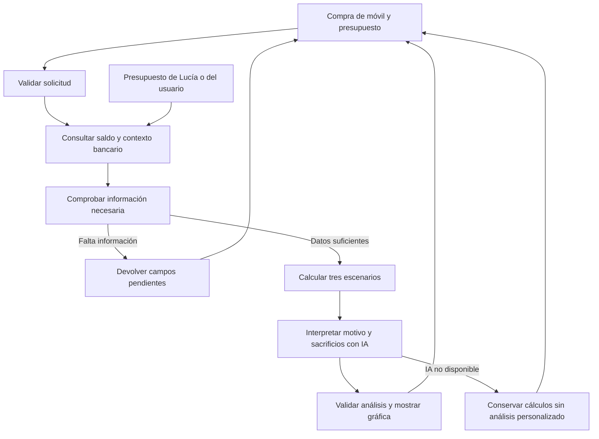

# Plan de implementación de SpendLab

SpendLab ayuda a un cliente de Banana Bank a decidir sobre la compra al contado de un móvil. Combina su saldo bancario actual, un presupuesto explícito y su motivo para comparar comprar ahora, vender primero el móvil anterior y esperar. La experiencia destaca por una gráfica interactiva y un análisis que conecta las consecuencias financieras con lo que la persona busca conseguir.

La V1 está implementada, incluida la interfaz, y el usuario ha revisado favorablemente su primera versión. Usa la fecha actual independiente del sistema documental, un ejemplo de presupuesto para Lucía y presupuesto manual para el resto. La V1.1 descrita al final es una evolución pendiente de validación e implementación. Esta revisión modifica únicamente Plan.md, Backend.md y Frontend.md; no añade código ni persistencia.

## V1 · Base actual

### Documentos y decisiones compartidas

- [Backend](Backend.md): fuentes, presupuesto, fechas, contratos HTTP, cálculo, workflow e interpretación.
- [Frontend](Frontend.md): formulario breve, revisión de datos, gráfica, análisis y estados.
- Este plan: alcance, integración, iteraciones y condiciones de aceptación.

Los tipos y reglas financieras se definen en Backend y se comparten con el front. El modelo interpreta resultados ya calculados; no establece saldos, fórmulas o clasificación financiera.

| Decisión        | MVP                                                                                                  |
| --------------- | ---------------------------------------------------------------------------------------------------- |
| Nombre          | SpendLab; texto visible `Spend Lab`.                                                                 |
| Compra          | Un móvil, al contado en euros. Sin selector de categorías ni catálogo de productos.                  |
| Comparación     | Comprar hoy, vender primero y esperar; baseline del presupuesto como referencia de la gráfica.       |
| Demo            | Lucía, con un presupuesto ficticio pequeño y editable.                                               |
| Otros clientes  | Saldo real de la API y presupuesto introducido manualmente.                                          |
| Tiempo          | Hoy según el reloj del servidor en UTC; horizonte común de 90 días. Reloj inyectable para tests.     |
| Recursos        | Cuentas elegidas explícitamente por el cliente y colchón editable.                                   |
| IA              | Una llamada que interpreta motivo, sacrificios y alternativas y plantea una reflexión personalizada. |
| Infraestructura | Next.js, React, Zod, SDK OpenAI, cliente bancario y trazas existentes; sin dependencias nuevas.      |
| Persistencia    | Un fixture para Lucía y estado local de la sección. Sin tablas o historial de decisiones nuevos.     |
| Idioma          | Inglés en el producto, coherente con la interfaz actual.                                             |

La fecha de referencia documental conserva su función para políticas y versiones. SpendLab no la importa como reloj ni modifica su valor. El presupuesto de demo se transforma en fechas futuras relativas al día actual; no depende de abril, septiembre o cualquier otro mes fijo.

### Arquitectura e integración

La navegación permanece en `app/page.tsx` y los endpoints en `app/api/[...path]/route.ts`. Se añade una pestaña de cliente y un despacho pequeño a la lógica de `src/spend-lab/`. La interfaz vive en componentes propios de `app/components/spend-lab/`. No se refactoriza el core para incorporar la feature.

Se reutilizan `actor`, `sameOrigin`, `bankRequest`, `openai()`, `config.chatModel`, `traceLog` y los patrones visuales existentes. El motor financiero es una función pura compartida para la respuesta del servidor y la vista previa del navegador. El agente actual conserva sus prompts, herramientas y comportamiento.

### Límites del MVP

- El saldo y la actividad observada proceden del banco por HTTP. Los datos de demo y los declarados por el usuario están identificados por separado. Ningún presupuesto sustituye al saldo ni se presenta como historial bancario.
- Solo Lucía tiene presupuesto de demo. No se generan cinco meses de historia ni perfiles para todos los clientes. El histórico limitado de la API no se utiliza para inferir un presupuesto completo o una nómina futura.
- La venta prevista y el calendario del presupuesto son hipótesis visibles. El resultado explica cuándo dependen de cobrar o mantener esos ingresos y gastos.
- El análisis valora la capacidad financiera y el valor personal por separado. No promete rentabilidad, satisfacción o ausencia de riesgo.
- No se modifican `simulator/`, el agente existente, transferencias, aprobaciones, persistencia ni el corpus e índice RAG.
- Financiación, otras categorías, gastos extra en listas, editor de recibos, precios externos, OCR, historial guardado y workflows durables quedan fuera.

### Iteraciones de implementación de V1

Las tareas se ejecutan una a una en `part-2`, en el entorno habitual, sin nuevos servicios o puertos. Antes de escribir código Next.js se leen sus guías locales pertinentes. Cada iteración sigue `AGENTS.md`: regla, escenario de partida, evidencia, decisión, implementación, repetición, checks, HowToDemo, revisión del usuario y commit.

| Iteración                      | Entrega                                                                                            | Validación y demo                                                                                                                      |
| ------------------------------ | -------------------------------------------------------------------------------------------------- | -------------------------------------------------------------------------------------------------------------------------------------- |
| 1. Datos y cálculo             | Contrato compartido, presupuesto de Lucía, presupuesto manual, reloj inyectable y tres escenarios. | Céntimos, fechas actuales/fijas, calendario, colchón, venta y espera con datos controlados. Comprobar separación de fuentes.           |
| 2. Workflow y API              | Contexto autorizado, dos endpoints, una llamada de IA y fallback de cálculos.                      | Sesión, titularidad, campos pendientes, errores de banco/modelo y análisis distinto para motivos distintos con las mismas cifras.      |
| 3. Experiencia visual y cierre | Formulario de móvil, presupuesto compacto, gráfica y análisis personalizado.                       | Demo completa con Lucía y cliente manual, preview sin texto obsoleto, cambio de persona, regresión del core, tests, typecheck y build. |

Cada iteración actualiza HowToDemo con escenarios y checks realmente realizados y revisa su diff frente a los límites anteriores. Se ejecutan pruebas focalizadas y typecheck al cambiar código; la integración de API añade regresión del core. El cierre ejecuta `npm test`, `npm run typecheck`, `npm run build` y `git diff --check`. Las pruebas live existentes se ejecutan contra la aplicación habitual cuando esté disponible y se declaran las omitidas. Los cambios adicionales requieren la aprobación prevista en `AGENTS.md`.

### Criterios de aceptación de V1

El cliente completa la compra sin escribir en un chat, revisa presupuesto y colchón, elige recursos y compara tres alternativas sobre una gráfica consistente. La interpretación explica por qué el móvil tiene sentido para su motivo, qué margen o protección sacrifica y qué pregunta concreta debería hacerse antes de decidir.

La demo principal utiliza Lucía y el saldo actual que devuelve el banco. Cambiar precio, colchón o fecha de venta recalcula una preview visible. La interpretación anterior desaparece hasta actualizar el análisis. La recomendación debe poder defender tanto un capricho asumible como esperar si la compra compromete los recursos.

Se demuestra además un cliente sin perfil de demo que completa su presupuesto manual. Los tests fijan fecha y saldo; la demo no resetea el banco ni presupone que los datos locales permanecen intactos. Evaluar no crea operaciones, intents, aprobaciones ni conversaciones.

El cierre verifica también Overview, Assistant, Transfers, Documents y selector de persona, con especial atención a solicitudes tardías. La revisión visual real del usuario y las limitaciones del modelo de presupuesto quedan registradas en HowToDemo.

### Revisión posterior

Las decisiones se revisan primero en estas especificaciones y después en la tarea correspondiente. La separación entre contexto, cálculo e interpretación deja abiertas futuras categorías y financiación, sin incorporarlas al MVP durante una iteración ya iniciada.

## V1.1 · Evolución propuesta, pendiente de validación

La V1.1 amplía el contexto de decisión y la ayuda para preparar el presupuesto. Reutiliza la sección, los dos endpoints, el motor financiero, la gráfica y la interpretación existentes. No rehace SpendLab ni incorpora financiación, investigación de productos o un loop de agente.

| Aspecto     | V1 actual                                                                             | V1.1 propuesta                                                                                                                                                                                                    |
| ----------- | ------------------------------------------------------------------------------------- | ----------------------------------------------------------------------------------------------------------------------------------------------------------------------------------------------------------------- |
| Clientes    | Todos los clientes pueden evaluar; Lucía tiene demo y el resto introduce presupuesto. | Mismo acceso para todos, con evidencia bancaria visible para preparar y confirmar las previsiones. Ningún cliente depende de un fixture.                                                                          |
| Presupuesto | Demo de Lucía precargada; cinco campos manuales para los demás.                       | Recorrido común con saldo y actividad reales disponibles; completar/confirmar los cinco campos. Lucía conserva una opción explícita de cargar el ejemplo, sin ser el presupuesto por defecto del nuevo recorrido. |
| Compra      | Móvil genérico; el producto puede aparecer en contexto libre.                         | Categoría y nombre concreto obligatorios en la nueva interfaz, además de precio, motivo y contexto.                                                                                                               |
| Categorías  | Móviles.                                                                              | Móviles, ordenadores, gaming y consolas, otros dispositivos tecnológicos.                                                                                                                                         |
| IA          | Una interpretación orientada a móviles.                                               | Una interpretación de producto, motivo, utilidad declarada, sacrificios, alternativas y pregunta personalizada.                                                                                                   |
| Cálculo     | Baseline, comprar ahora, vender primero y esperar, durante 90 días.                   | Mismas fórmulas, escenarios y controles. Categoría y nombre no alteran las cifras.                                                                                                                                |
| Historial   | Estado local; no se guarda la evaluación.                                             | Sigue fuera del alcance de implementación propuesto, pendiente de decisión del usuario.                                                                                                                           |

### Datos bancarios y cobertura de todos los clientes

El problema no es habilitar siete clientes nuevos: V1 ya acepta sus cuentas y presupuesto manual. La mejora consiste en ayudarles a completar ese presupuesto con los datos realmente disponibles, sin atribuirles un perfil ficticio.

Se reutilizan las cuentas y hasta 100 movimientos de la API externa. El backend obtiene un resumen determinista de entradas y salidas observadas por cuenta y mes UTC; el front muestra únicamente las cuentas seleccionadas y su cobertura. Es una referencia histórica, no un presupuesto mensual inferido. El límite puede afectar a cualquier mes; tampoco hay garantía de cobertura completa si se devuelven menos de 100 movimientos.

Los movimientos contienen importe, fecha, descripción y referencia de operación, pero no categorías de gasto, contratos de nómina o vencimientos futuros. Una entrada puede ser apertura de cuenta o transferencia; una salida no determina si es esencial. Por ello V1.1 no transforma totales en nómina, no anualiza meses parciales ni rellena automáticamente esenciales/discrecionales o próximas fechas. Los cinco campos siguen siendo previsiones revisadas por la persona. Si no hay evidencia suficiente, se pide información; si falta actividad, puede continuar con saldo y presupuesto declarado.

Se mantienen los orígenes `bank`, `demo` y `user`. El resumen bancario deriva solo de movimientos reales. Un valor confirmado o ajustado para proyectar el futuro es una hipótesis `user`, aunque se haya consultado el histórico. El perfil de Lucía permanece en su fixture, con etiqueta de ejemplo y activación explícita. No se añaden perfiles, históricos sintéticos, presupuestos hardcodeados ni lecturas directas de la BD del simulador.

### Producto e interpretación con una llamada

El nuevo formulario solicita categoría, producto concreto, precio y motivo; el contexto opcional explica uso esperado, necesidad, urgencia o qué dispone ya la persona. No se añade catálogo, buscador, URL obligatoria o ficha técnica. [Backend](Backend.md) define la extensión compatible del contrato y [Frontend](Frontend.md) los controles.

La llamada actual es suficiente como punto de partida: ya recibe declaraciones y resultados calculados y devuelve interpretación, recomendación, tradeoffs y pregunta. Se amplía su payload e instrucciones y se conservan el modelo configurado, la salida estructurada y el fallback. No se añade otra llamada ni se permite a la IA modificar cálculos o completar el presupuesto.

La IA explica qué utilidad podría tener el producto según lo declarado, qué se sacrifica financieramente y qué alternativas merecen consideración. Comprar un ordenador para una necesidad laboral descrita requiere una lectura distinta de renovar un móvil por disfrute, sin prometer productividad, rentabilidad o ingresos. Si faltan razones concretas, la pregunta explora esa incertidumbre. El nombre del producto no prueba sus características, su precio de mercado o su valor de reventa.

Las alternativas cuantificadas siguen siendo las tres actuales. Reparar, conservar lo que se tiene o valorar una opción más económica pueden aparecer como reflexiones condicionales si encajan; no reciben precios inventados ni nuevas curvas. No se recomienda financiación ni se juzga moralmente una compra. Solo se reconsiderará el protagonismo de la IA si las pruebas de estos casos demuestran una limitación concreta; eso requerirá una nueva decisión, no se incluye de antemano.

### Integración e iteraciones de V1.1

| Iteración                       | Cambio acotado                                                                                                             | Validación requerida                                                                                                                                                               |
| ------------------------------- | -------------------------------------------------------------------------------------------------------------------------- | ---------------------------------------------------------------------------------------------------------------------------------------------------------------------------------- |
| 1. Contexto y contratos         | Categoría/producto, compatibilidad del input V1, resumen de actividad por cuenta y presupuesto común con ejemplo opcional. | Todos los clientes existentes, cuentas elegidas, fuentes, actividad parcial/antigua/vacía/no disponible y completar datos sin usar demo. Mismas cifras con igual input financiero. |
| 2. Experiencia e interpretación | Controles de categoría/producto, textos neutrales de dispositivo, evidencia al revisar presupuesto y prompt actualizado.   | Cuatro categorías; análisis distintos según producto y motivo, ninguna característica inventada; editar retira texto anterior, cambio de persona y fallback.                       |
| 3. Cierre                       | Ajustes necesarios de integración y documentación de demo.                                                                 | Regresión V1/core, tests pertinentes, typecheck, build y diff; revisión visual del usuario. Sin historial.                                                                         |

Cada iteración mantiene el ciclo de `AGENTS.md` y actualiza HowToDemo cuando se implemente. Esta fase solo cambia las tres especificaciones. No se modifican `simulator/`, agente existente, transferencias, aprobaciones, navegación de operadores, persistencia, dependencias o infraestructura. El reloj actual, céntimos, horizonte, colchón, reventa declarada y preview conservan las reglas V1.

La aceptación exige completar una evaluación para cualquiera de los ocho clientes sin cargar el ejemplo de Lucía. No exige que el banco contenga datos suficientes para rellenar todo: exige usar los disponibles, explicar límites y solicitar el resto. Cambiar solo categoría/producto/motivo mantiene la proyección financiera y cambia la interpretación cuando el contexto lo justifica.

### Historial · Evaluación de una evolución posterior

La revisión del código confirma que `SpendLab.tsx` mantiene formulario y resultado en estado React y los pierde al desmontarse. El workflow no llama a `appDb()` ni escribe evaluaciones; `traceLog` emite logs y `store: false` no crea un historial consultable del producto. El `runId` correlaciona una ejecución, pero no permite recuperar su resultado.

Un historial aportaría continuidad: consultar una evaluación, usarla como punto de partida y comparar una nueva reflexión con la anterior. Para ello harían falta almacenamiento propio en la SQLite de la aplicación, endpoints autorizados por cliente, snapshots versionados y una interfaz de lista, detalle y recuperación. No se deben reutilizar conversaciones, intents o movimientos bancarios como historial. Backend y Frontend detallan esta propuesta sin autorizar su implementación.

| Opción                               | Coste e implicaciones                                                                                   | Valoración                                                             |
| ------------------------------------ | ------------------------------------------------------------------------------------------------------- | ---------------------------------------------------------------------- |
| Mantener estado local                | Ninguna tabla o pantalla nueva; se pierde al salir.                                                     | Alcance recomendado para V1.1.                                         |
| Guardar en localStorage              | Menos backend, pero solo ese navegador; hay que aislar personas, versionar y gestionar datos obsoletos. | No ofrece un historial bancario consistente; no se incluye como atajo. |
| Historial en SQLite de la aplicación | Complejidad media adicional: schema, autorización, guardado, versiones, recuperación y comparación.     | Útil como entrega posterior separada, recomendada V1.2 si se valida.   |

Una evaluación antigua es un snapshot, no una promesa vigente. Recuperarla reutiliza declaraciones, vuelve a consultar banco y reloj, exige actualizar fechas pasadas y crea una evaluación nueva. Comparar debe explicar diferencias de saldo, fecha, presupuesto y producto; no atribuir todos los cambios al producto o al modelo.

**Decisión pendiente:** el usuario debe decidir si adelanta el historial a V1.1 o acepta posponerlo. Hasta entonces no se implementa. Si lo aprueba, hay que cerrar guardado explícito o automático, datos y versiones a conservar, retención/borrado y si la primera entrega incluye comparación o solo consulta y recuperación. La recomendación es cerrar primero categorías, presupuesto común e interpretación; el historial añade un flujo independiente y no mejora por sí solo el análisis de esta demo.
